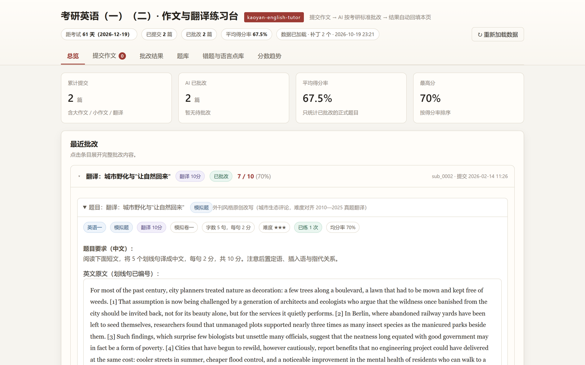
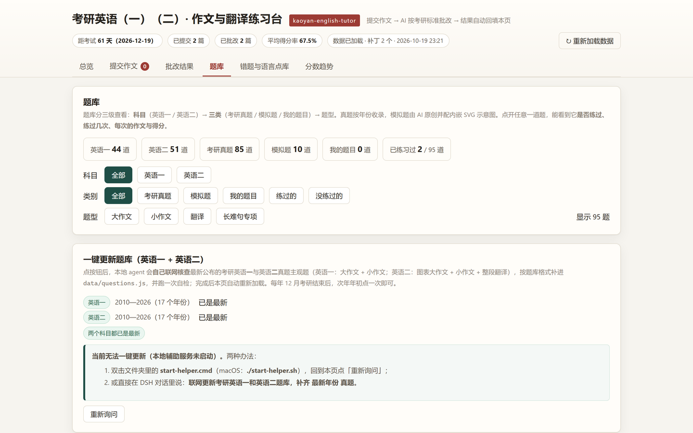
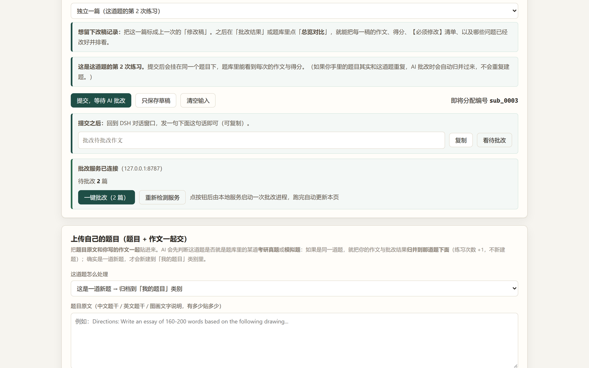
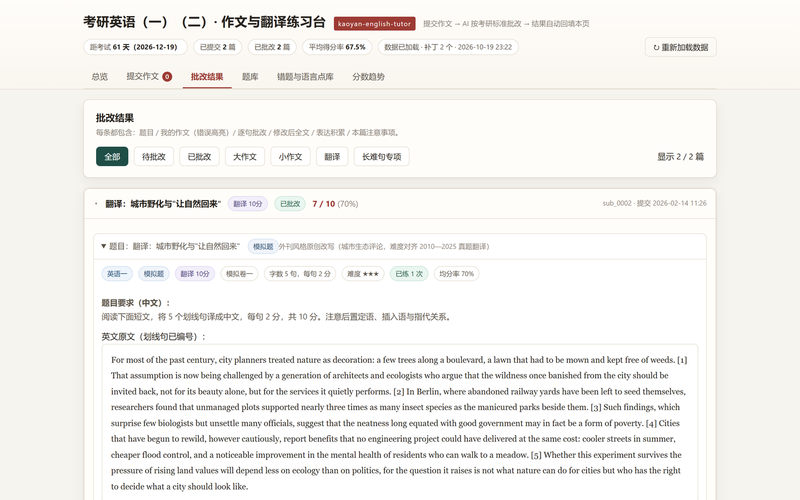
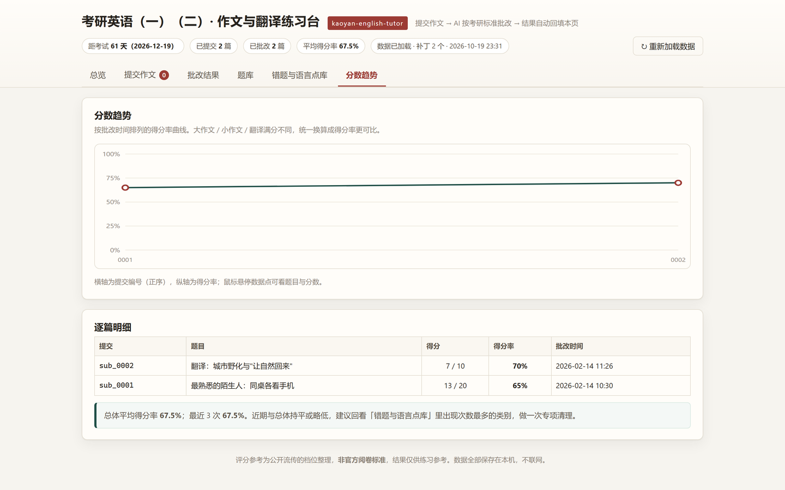

# 考研英语（一）（二）· 作文批改练习台

一个**装在自己电脑上**的考研英语作文练习工具：网页负责写作与查看，AI 负责按评分标准逐句批改，两边靠本地文件自动同步。

**同时支持考研英语一与英语二**（分科目筛选、分科目评分标准、分科目统计）：

| | 英语一 | 英语二 |
|---|---|---|
| 大作文 | 20 分，160—200 词（图画作文；2024 起出现图表） | **15 分，约 150 词（图表作文）** |
| 小作文 | 10 分，约 100 词 | 10 分，约 100 词 |
| 翻译 | 10 分，5 个划线句 | **15 分，整段英译汉** |

- 题库：**真题 85 道**（英语一 34：2010—2026 大作文+小作文；英语二 51：2010—2026 大作文+小作文+翻译）+ 原创模拟题 9 道 + 长难句专项 1 道
- 批改：**按官方档位表定档**（`skill/references/rubric_kaoyan.md`）+ 逐句批改 + 修改后全文 + 表达积累 + 本篇注意事项
- 提分：**高级词汇升级 + 高级语法升级**（非谓语/倒装/强调/虚拟/独立主格/名词化等 18 种，见 `highscore_language.md`）
- 模板：**多文体高分模板库**（图画/图表/书信/通知/备忘录/六级议论文/六级翻译，各含"稳"与"进阶"两套，见 `templates_library.md`）
- 理论：名师与机构方法论共识/分歧（王江涛、朱伟、潘赟、石雷鹏、刘晓艳、唐迟、何凯文、张剑等），见 `master_methods.md`
- **同时支持六级（CET-6）作文**：按 15 分五档（14/11/8/5/2）独立口径批改，见 `rubric_cet6.md`
- 复盘：错题自动按语法类别归库、分数趋势、同一篇作文的改稿并排对比
- 离线：网页零外链、零请求，断网照常用；数据全部在你自己的文件夹里
- 更新：网页里点「一键更新题库」，AI 自己联网**同时补英语一与英语二**的最新真题（为下一年考生准备）

---

## 界面预览

> 截图来自本机实际运行（1440×900，2 倍图）。完整图文步骤见 **[操作手册（PDF）](docs/操作手册.pdf)**。

<div align="center">



<sub><b>总览</b>：距考试倒计时 · 已提交/已批改篇数 · 平均得分率 · 最近批改（点条目展开完整批改）</sub>

<br><br>



<sub><b>题库</b>：科目（英语一/英语二）→ 类别（真题/模拟/我的题目）→ 题型（大作文/小作文/翻译/长难句）三级筛选</sub>

<br><br>



<sub><b>一键批改</b>：服务连接后点按钮，网页先把本机提交同步成 <code>data/pending_submissions.json</code>，AI 读它批改</sub>

<br><br>



<sub><b>批改结果</b>：档位 + 分项评价 + 逐句批改 + 采分点表 + 修改后全文 + 词汇/语法升级</sub>

<br><br>



<sub><b>复盘</b>：错题按语法类别归库、得分率趋势、同一篇作文的多稿并排对比</sub>

</div>

---

## 1. 三分钟开始

### 第 0 步：解压到哪里（下载 zip 之后，这一步别随手点）

整个文件夹就是你的数据目录：提交记录、批改补丁、手写照片都写在里面，所以位置要选对。

**只有 C 盘的电脑**

- ✅ **推荐**：`%USERPROFILE%\kaoyan-english-writing\`（就是你的**用户目录**，在「此电脑 → C 盘 → 用户 → 你的名字」下面）
  - 用户目录你天然有写权限，不需要管理员；
  - 路径短、层级浅，没有同步客户端插手；
  - 想更好找也可以放在 `文档` 下（前提是它没被 OneDrive 接管，见下面 ⚠️）。
- ⚠️ **别放**：`C:\Program Files\`、`C:\Program Files (x86)\`、`C:\Windows\` —— 这些位置默认需要管理员权限，脚本往 `app\data\patches\` 写补丁时容易被拒。
- ⚠️ **别放 OneDrive 同步的"桌面 / 文档"**：右键该文件夹 →「属性」→「位置」，如果显示的是 `...\OneDrive\...`，说明它在云同步里。云同步会锁文件、回滚版本，一旦两台电脑同步过，同一个 `sub_0001` 编号会出现两份（正是 §2.2 的编号撞车）。


**有 C 盘 + D 盘（或其他数据盘）的电脑**

- ✅ **推荐**：`D:\kaoyan-english-writing\`
  - 不占系统盘；**重装系统时提交记录与补丁不会跟着 C 盘一起没**；
  - 路径短、无云同步。
- ✅ 前提：这个盘要**内置固定盘**，不要用移动硬盘 / U 盘 / 网盘挂载盘 —— 拔盘或掉线会让网页"数据加载失败"，批改写到一半会写坏。
- 判断盘的类型（`3` = 内置固定盘，`2` = 可移动盘）：

  ```powershell
  wmic logicaldisk get deviceid,drivetype,freespace
  ```
- D 盘也满了，就挑**空间最多的那个内置盘**，原则一样。


**还有三条**

1. **整包解压，保持目录结构**；只把 `app/index.html` 单独拷出来是无效的（它要用同层的 `app/data/`）。
2. 路径建议**纯英文、无空格、层级浅**（如 `D:\kaoyan-english-writing`）。中文与括号**实测可用**，但越简单越少意外；总路径也别太长（Windows 有 260 字符上限）。
3. **只保留一份**。不要"旧版一份、新版一份"同时在两个浏览器里用：提交记录按浏览器保存，两份会让编号重复（见 §2.2）。

---

### 第 1 步：装好（只需一次）

**Windows：双击 `install.cmd`**（会自己找 DSH 自带的 node，**不需要先装 Node.js**）；macOS / Linux：`node install.js`（或 `./install.sh`）。

```bash
node install.js          # 等价命令（前提：PATH 里有 node；Windows 建议直接用 install.cmd）
```

`install.js` 会做三件事：自检文件是否齐全、把评分标准安装到 DSH 用户技能目录、打印你所在平台的下一步操作。**不需要手工改任何个人信息。**

<details>
<summary>Windows / macOS 分别怎么做（点开看）</summary>

**Windows**

1. 双击 **`install.cmd`** —— 它会自动查找 DSH 自带的 node（PATH → DSH 安装位置 → 各盘符 → 注册表卸载项）；找不到才提示你安装 Node.js
2. 自检通过后，双击 `app\index.html` 开始写作
3. 要批改时：双击 `一键批改.cmd`，或先 `start-helper.cmd` 再回网页点「一键批改」

> 只有"没装 DSH、也没有 Node.js"时才需要到 <https://nodejs.org/> 下载 LTS 版安装。

**macOS / Linux**

```bash
chmod +x *.sh                 # 从网上下载的脚本默认没有执行权限
node install.js               # 或 ./install.sh
```

macOS 首次运行脚本若被系统拦下：右键脚本 →「打开」→ 确认一次即可。

</details>

### 第 2 步：打开网页

双击 `app/index.html`（macOS 也可在终端执行 `open app/index.html`）。

### 第 3 步：让 AI 批改（三种方式任选）

| 方式 | 怎么做 | 适合 |
|---|---|---|
| **A. 网页按钮** | 先运行 `start-helper.cmd` / `./start-helper.sh`，再在网页点「一键批改」 | 连练好几篇 |
| **B. 一次性脚本** | 双击 `一键批改.cmd`，或终端 `node tools/grade-once.js`（macOS 可 `./grade-once.sh`） | 不想常驻程序 |
| **C. 直接在对话里说** | 打开 DSH（或其他智能体），说一句 **批改待批改作文** | 想顺带追问细节 |

三种方式都会启动一次**独立的无界面批改进程**（跑完自动退出），不需要你开着 DSH 窗口。

---

## 2. 环境、浏览器与"虚假提交"（重要，建议先读）

### 2.1 要不要配置环境变量？——正常安装**不需要**

三种批改方式都依赖两个外部程序：**node**（跑脚本）与 **dsh**（启动智能体）。脚本会自己去找，查找顺序是：

| 找什么 | 查找顺序（找到就用，不再往下找） |
|---|---|
| `node` | ① PATH 里的 node ② `%DSH_HOME%\..\dsh\resources\runtime\primary-runtime\...` ③ `%LOCALAPPDATA%\Programs\DSH\...`、`%ProgramFiles%\DSH\...` ④ **各盘符根目录**（`C:\dsh\...`、`D:\dsh\...`、`E:\dsh\...` …） |
| `dsh` | ① PATH ② 从当前 node 位置逐级反推 ③ `DSH_HOME` 推断 ④ 常见安装位置 ⑤ **各盘符根目录**的 `dsh\resources\runtime\cli\bin\dsh.cmd` ⑥ **读注册表卸载项的 `InstallLocation`**（安装器把真实安装位置写在这里，最可靠） |

也就是说：**只要 DSH 是正常安装的（哪怕装在 D:\、E: 等非系统盘、或自定义目录），就不用手工配 PATH**；脚本里没有写死任何一台电脑的路径。上面⑥条是兜底：`install.js`、`tools/grade-once.js`、`app/tools/grade-helper.js` 三处实现一致，并由 `node tools/test-guards.js` 守着（含"PATH 与盘符都不命中、只有注册表可用"的隔离测试）。

什么时候仍然需要手工配置：

- DSH 装在**很不常规的位置**（如 `D:\tools\my-dsh\`，不是盘符根目录下的 `dsh`）：把 `<DSH安装位置>\resources\runtime\cli\bin` 加入 PATH（Windows：系统属性 → 环境变量 → 用户变量 `Path`）；
- 你用**别的智能体**（Codex / Cursor 等）：见第 6 节；
- 改完 PATH 后，**已经开着的命令行窗口不会生效**，请关掉重开。

排错命令：

```bash
node app/tools/validate.js     # 数据文件、补丁字段、分值自洽
node app/tools/validate.js --report   # 额外做页面渲染仿真
node tools/check-repo.js       # 仓库自检（路径、命令、机器专属信息、两科完整性）
node tools/test-guards.js      # 两个"守卫"回归自检（dsh 定位三处一致 + 补丁防编号撞车）
```

### 2.2 批改时最好**只开一个浏览器**（强烈建议）

网页的提交记录保存在**浏览器自己的 local-storage 里**，不是文件：

- 不同浏览器（Edge / Chrome / Safari）之间**互不相通**；同一个浏览器的不同"用户配置"也不相通。
- 因此在两个浏览器里打开同一个练习台时会出现：A 浏览器提交的作文，B 浏览器里"看不见"；更麻烦的是**编号会重复**（两边都从 `sub_0001` 开始）。
- 编号重复的后果：批改结果文件（`app/data/patches/` 下的 `sub_XXXX.js`）是**按编号匹配**的，A 的批改结果有可能被显示到 B 的作文上。

**已有的防护**：补丁里必须带 `questionId`。页面加载补丁时会先比对题目，**对不上就拒绝套用**，顶栏显示

> ⚠ sub_XXXX：批改补丁的题目与这条提交不一致，已忽略该结果（疑似编号撞车…）

并且这条提交会继续显示为「待批改」，不会被别人的分数冒充。

**建议**：固定用一个浏览器练习。真要换浏览器，先在旧浏览器点「错题与语言点库 → 导出本机提交 JSON」备份，换过去后继续用，并确保同一编号只保留一份记录。

### 2.3 会不会出现"虚假的提交"？——会，共 3 种来源

| 来源 | 现象 | 怎么处理 |
|---|---|---|
| **空提交** | AI 看到一条没有正文的提交（可能只有图片路径） | 网页已拦截"正文和图片都没有"的提交；**图片提交请务必先点「保存到 data/uploads/」把图片真的存进文件夹**，否则 AI 无内容可批 |
| **服务端残留** | 网页里已经删掉/清空了，AI 却还看到一条待批改 | 打开辅助服务会生成 `app/data/pending_submissions.json`；**清空网页数据后请把这个文件一并删掉**——辅助服务是按 id **合并**的，不会自动删除旧条目 |
| **只有补丁、没有提交** | 网页上出现一条题目显示「（自定义题目）」的空记录 | 说明 `app/data/patches/` 里有对应的 `sub_XXXX.js`，但浏览器里没有这条提交；删掉那个补丁文件，或点网页右上角「重新加载数据」 |

**"先提交了一个空的 sub_0001，紧接着提交 sub_0002，会不会错配？"**

- **编号不会互相阻塞**：`sub_0001` 没批改也照样分配 `sub_0002`（编号 = 已见过的最大号 + 1，与"批没批完"无关）；撤回某篇也不会让号回退。
- **不会把结果套到第二篇上**：补丁按 id 精确对应，页面还会用 `questionId` 二次校验；`sub_0001` 的批改结果只会挂在 `sub_0001` 上。
- **真正要留意的是**：那条空的 `sub_0001` 会一直留在"待批改"清单里，一键批改会连带它一起交给 AI。请**补全正文，或在网页里删掉它**（删掉后顺手清掉 `app/data/patches/` 里同编号的补丁文件，如果有的话）。
- **同一道题写多稿**：提交页第 6 项选「某一篇的修改稿」，两稿会归到同一篇作文下并排对比，而不是散成两条互不相关的记录。

### 2.4 三条"数据一致性"好习惯

1. **一次只用一个浏览器**练习（见 2.2）。
2. 清空本机数据之后，**顺手删除 `app/data/pending_submissions.json`**（见 2.3）。
3. 想彻底重来：网页点「错题与语言点库 → 清空本机数据（提交/草稿/图片/批改缓存）」，再清空 `app/data/patches/` 里对应的 `sub_XXXX.js`。

---

## 3. 常见问题：要不要手动改什么？

**不用。** 下面是全部可能需要"个性化"的地方，全都可选：

| 想做的事 | 怎么做 |
|---|---|
| 设置考试日期（顶栏倒计时） | 对 AI 说「把考试日期改成 2027 年 12 月 25 日」，或自己改 `app/data/state.js` 里的 `examDate` |
| **练英语一还是英语二** | 网页「题库」页顶部有**科目切换**（全部 / 英语一 / 英语二）；提交页的选题目下拉也按科目分组 |
| 换默认智能体 | `node tools/grade-once.js --agent codex`，或用 `--cmd "你的命令 {task}"` |
| 换批改服务端口 | `node app/tools/grade-helper.js --port 8899` |
| 不想要示例记录 | 本项目**默认不带任何个人记录**（`app/data/state.js` 是空模板），无需清理 |
| 想先看效果 | 把 `examples/patches/` 里的两个补丁复制到 `app/data/patches/`，再把 `examples/demo-submissions.js` 里的两条提交复制进 `app/data/state.js` 的 `draft` 数组 —— 网页就会显示两条完整批改（大作文 13/20、翻译 7/10） |
| 目录名 / 位置 | 文件夹**名字**随便改（项目内全部使用相对路径）；**放在哪里**见第 1 节「第 0 步」（别放 `Program Files`、云同步目录、移动盘，且只保留一份） |

**唯一不要做的**：别把 `app/index.html` 单独复制到别处（它要用同层的 `app/data/`）。

---

## 4. 网页里有什么

| 标签页 | 作用 |
|---|---|
| **总览** | 提交数、已批改、平均得分率；待批改清单；题库练习进度；当前最需要治的问题 |
| **提交作文** | 写新作文；**上传自己的题目**（题目 + 作文一起交）；一键批改面板 |
| **批改结果** | 每条含：题目 / 我的作文（红黄绿三色高亮）/ 逐句批改 / 修改后全文 / 表达积累 / 本篇注意事项 |
| **题库** | **95 道题，先按科目（英语一 / 英语二）再按类别（考研真题 / 模拟题 / 我的题目）筛选**；顶部有 **一键更新题库**（同时覆盖两科）；点开每题可看练习与改稿记录 |
| **错题与语言点库** | 历次【必须修改】自动按语法类别归库，附原句、改法、自查方法；下方是表达积累库 |
| **分数趋势** | 得分率曲线 + 逐篇明细，自动对比"总体平均"与"最近 3 次" |

**提交页的 6 个分点属于同一次提交**（1 选题 · 2 正文 · 3 手写照片 · 4 图片路径 · 5 附加要求 · 6 与这道题的关系）。同一道题想练第二遍，就再走一遍并再提交一次；选第 6 项为「某一篇的修改稿」，就能在「改稿总览」里并排对比各稿的得分与问题是否解决。

详细操作见 **[docs/操作手册.pdf](docs/操作手册.pdf)**（16 页图文版）。

---

## 5. 每年更新题库（为下一年考生）

每年 12 月考研结束后，点一次网页「题库 → 一键更新题库」：

1. 面板**分科目**显示当前覆盖与缺失年份（例：`英语一 2010—2026 已是最新` / `英语二 2010—2026 已是最新`）
2. 点按钮 → AI 联网交叉核对多个来源，**同时补英语一与英语二**：
   - 英语一：大作文（20 分）+ 小作文（10 分）
   - 英语二：图表大作文（15 分）+ 小作文（10 分）+ 整段翻译（15 分）
3. **更新前自动备份**到 `app/data/backups/`（保留 10 份），出问题可一键回退
4. 网页检测到变化后自动重新加载

不用网页按钮也可以：`node tools/grade-once.js --update 2027`（macOS：`./update-bank.sh 2027`）。

> 查不到的细节 AI 会标注「不确定」，不会编造。更新后建议跑一次 `node app/tools/validate.js`。

---

## 6. 在其他智能体里使用（Codex / Cursor / Claude Code …）

网页、题库、批改结果都是普通文件，任何能读写本地文件的智能体都能接手。区别只在「评分标准放在哪」：

| 智能体 | 做法 |
|---|---|
| **DSH** | `node install.js` 自动装到 `~/.dsh/skills/kaoyan-english-tutor/`，任何会话可用 |
| **Codex** | 仓库根的 [`AGENTS.md`](AGENTS.md) 会被自动读取 |
| **Cursor** | 新建规则：批改考研英语作文时读 `skill/SKILL.md` 及其 references |
| **Claude Code** | 把 `skill/SKILL.md` 并进 `CLAUDE.md`，或复制 `skill/` 到 `.claude/skills/` |
| **任意命令行智能体** | `node tools/grade-once.js --cmd "your-agent -p {task}"` |

**核心只有一句话**：读 `app/data/pending_submissions.json`（网页自动同步）与 `app/data/state.js` 里 `status:"pending"` 的提交 → 按 `skill/` 的标准批改 → 按 `skill/references/web_bridge.md` 的字段写成 `app/data/patches/sub_XXXX.js`。任何智能体照这句做，网页就能显示结果。

> 注意：网页里的提交平时存在浏览器 localStorage 里，只有**点过「一键批改」（网页按钮）**或**运行过辅助服务/`一键批改.cmd`**之后才会落到 `app/data/pending_submissions.json`。如果你换了一个智能体、它什么都没读到，先让用户在网页上点一次「一键批改」（会提示"同步"），或点「导出本机提交 JSON」另存为 `app/data/pending_submissions.json`。

---

## 7. 目录结构

```
kaoyan-english-writing/
├─ README.md                  ← 本文件
├─ AGENTS.md                  ← 给 Codex 等智能体的工作说明
├─ install.js                 ← 一键安装与自检（跨平台）
├─ install.cmd                ← Windows：双击即安装自检（自动找 DSH 自带 node）
├─ grade-once.sh              ← macOS / Linux：一次性批改
├─ start-helper.sh / stop-helper.sh / update-bank.sh
├─ 一键批改.cmd / start-helper.cmd / stop-helper.cmd / 更新题库.cmd   ← Windows
├─ docs/
│  ├─ 操作手册.pdf             ← 16 页图文版使用说明
│  ├─ 操作手册.html            ← 上面那份的源文件
│  ├─ windows-安装说明.md
│  └─ macos-安装说明.md
├─ examples/                  ← 可选的示例数据（想先看看界面效果时复制进 app/data/）
│  ├─ demo-submissions.js     ← 两条示例提交
│  └─ patches/                ← 两条示例批改补丁
├─ app/                       ← 练习台（可单独拷走使用）
│  ├─ index.html
│  ├─ data/
│  │  ├─ state.js             ← 考试日期 + 你的提交记录（可编辑）
│  │  ├─ questions.js         ← 题库（生成产物，不要手改）
│  │  ├─ figures.js           ← 示意图库
│  │  ├─ pending_submissions.json ← 网页/辅助服务同步过来的本机提交（AI 读这份）
│  │  ├─ patches/             ← AI 写回的批改结果
│  │  ├─ uploads/             ← 手写作文照片
│  │  └─ backups/             ← 更新题库前的自动备份
│  └─ tools/
│     ├─ validate.js          ← 自检（数据 + 页面渲染仿真 + 两科年份完整性）
│     ├─ grade-helper.js      ← 网页按钮背后的本地服务
│     ├─ gen-questions.js     ← 题库生成脚本（英语一 + 英语二 + 模拟题）
│     ├─ en2-data.js          ← 英语二真题数据（2010—2026）
│     └─ mock-data.js         ← 模拟题与长难句专项数据源
├─ skill/                     ← 批改标准（智能体读的提示词）
│  ├─ SKILL.md                ← 主入口：流程、科目/题型路由、通用守则
│  └─ references/             ← 官方评分标准（考研/六级）+ 各题型模块 + 高级词汇语法库 + 模板库 + 名师方法论 + 数据契约
├─ tools/
│  ├─ grade-once.js           ← 跨平台一次性任务（批改 / 更新题库）
│  ├─ check-repo.js           ← 仓库复现性检查（路径、命令、个人信息、两科完整性）
│  ├─ check-ref-json.js       ← 校验技能文档里的补丁模板是否真的可解析
│  ├─ make-examples.js        ← 重新生成 examples/
│  └─ gen-win-scripts.js      ← 重新生成 Windows 批处理脚本
└─ .dsh/skills/kaoyan-english-tutor/   ← DSH 项目级技能副本（克隆后即用）
```

---

## 8. 批改标准（可自行调整）

`skill/references/` 下每个文件都是一份可编辑的提示词：

| 文件 | 内容 |
|---|---|
| `english1_essay_major.md` | 英语一大作文六档评分、批改原则、**图画作文与图表作文两套检查清单** |
| `english1_essay_minor.md` | 英语一小作文五档评分、书信/通知/告示格式检查 |
| `english1_translation.md` | 英语一翻译采分点制（每句 3—4 点合计 2 分）、长难句四步拆解 |
| `english2_essay_major.md` | **英语二图表大作文**五档（15 分）、图表解读专项清单（趋势/占比/数据取舍/倍数表达） |
| `english2_essay_minor.md` | **英语二小作文**（10 分）五档、按文体（书信/通知/备忘录）的格式清单 |
| `english2_translation.md` | **英语二整段翻译**（15 分）按点给分、意群拆分、错别字规则 |
| `translation_long_sentence.md` | 外刊长难句专项（★1—★5 难度、得分率反馈），两科通用 |
| `web_bridge.md` | **数据契约**：字段定义（含 `subject`）、判重归并规则、题库更新规则、补丁模板 |

想调整严格度或讲解风格，直接改这些文件即可（例如把"讲透语法四步"改成三步）。改完运行 `node app/tools/validate.js` 确认数据仍然合法。

---

## 9. 自检与排错

```bash
node app/tools/validate.js            # 检查数据文件、补丁字段、分值自洽
node app/tools/validate.js --report   # 额外用 DOM 仿真检查页面渲染
node tools/test-guards.js             # 守卫回归自检：dsh 定位三处一致 + 补丁防编号撞车
```

| 现象 | 处理 |
|---|---|
| 顶栏提示读不到 `data/state.js` | 确认 `app/index.html` 与 `app/data/` 在同一层 |
| 提交后网页看不到批改结果 | 确认补丁是 `app/data/patches/sub_XXXX.js`（**必须是 .js**）；点「重新加载数据」 |
| 题库显示 0 道题 | 页面会给出诊断：通常是 `app/data/questions.js` 里调用了 `figures.js` 中不存在的图函数；跑 `validate.js` 看具体报错，或用「回退到更新前的备份」 |
| 网页按钮点了没反应 | 辅助服务没启动：运行 `start-helper.cmd` / `./start-helper.sh` |
| AI 说「没有待批改的作文」 | 网页里的提交还在浏览器本地，先点一次网页上的「一键批改」（会把提交同步成 `app/data/pending_submissions.json`），或点「导出本机提交 JSON」另存为 `app/data/pending_submissions.json` |
| 一键批改.cmd 报找不到 node | 脚本会自己找 PATH / DSH 自带运行时 / 各盘符根目录；都找不到就装一个 Node.js 18+（<https://nodejs.org/>），或在 DSH 里打开本文件夹的会话运行 |
| 一键批改.cmd 报找不到 dsh | 脚本会自己找 PATH / DSH 安装位置 / 各盘符根目录；仍找不到时，把 `<DSH安装位置>\resources\runtime\cli\bin` 加入 PATH，或改用「方式 C：在对话里说『批改待批改作文』」 |
| 改完 PATH 还是找不到 | **已经开着的命令行窗口不会自动生效**，关掉重新双击脚本 |
| 顶栏提示「⚠ sub_XXXX：批改补丁的题目与这条提交不一致」 | 编号撞车（多半是另一个浏览器 / 另一台电脑用了同一个编号）：确认 `app/data/patches/sub_XXXX.js` 不是你的这篇，删掉它，然后重新批改 |
| 网页上出现题目为「（自定义题目）」的空记录 | 有补丁没提交：删掉 `app/data/patches/` 里对应的 `sub_XXXX.js`，或点右上角「重新加载数据」 |
| 清空本机数据后 AI 仍看到旧提交 | 删除 `app/data/pending_submissions.json`（辅助服务按 id 合并，不会自动删除旧条目） |
| 换了浏览器看不到之前的提交 | 提交存在各浏览器自己的 local-storage 里：回到原来的浏览器，或先「导出本机提交 JSON」再换；详见第 2.2 节 |
| 「一键批改.cmd」窗口停住不动 | 它会在窗口里显示原因（如找不到 dsh / node），不会一闪而过；把内容发给 AI 看 |
| 分数统计对不上 | 跑 `validate.js`，它会指出具体哪个补丁数值不一致 |

---

## 10. 说明与免责

- 评分参考为**公开流传的档位整理，非官方阅卷标准**，结果仅供练习参考，不构成分数承诺。
- 真题只提供**题干与写作要求**（不含官方范文）；真题使用中的图画 / 图表均为**本项目自绘示意图**，非原卷图片，请以真题原卷为准。
- 模拟题、示意图、题库结构均为**原创**。
- 全部数据保存在本机；网页不联网、不上传任何内容。「一键更新题库」会联网检索公开资料，仅在你点击时发生。

## 11. 许可

[MIT](LICENSE)
